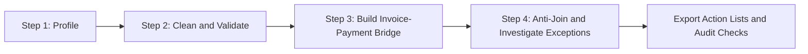
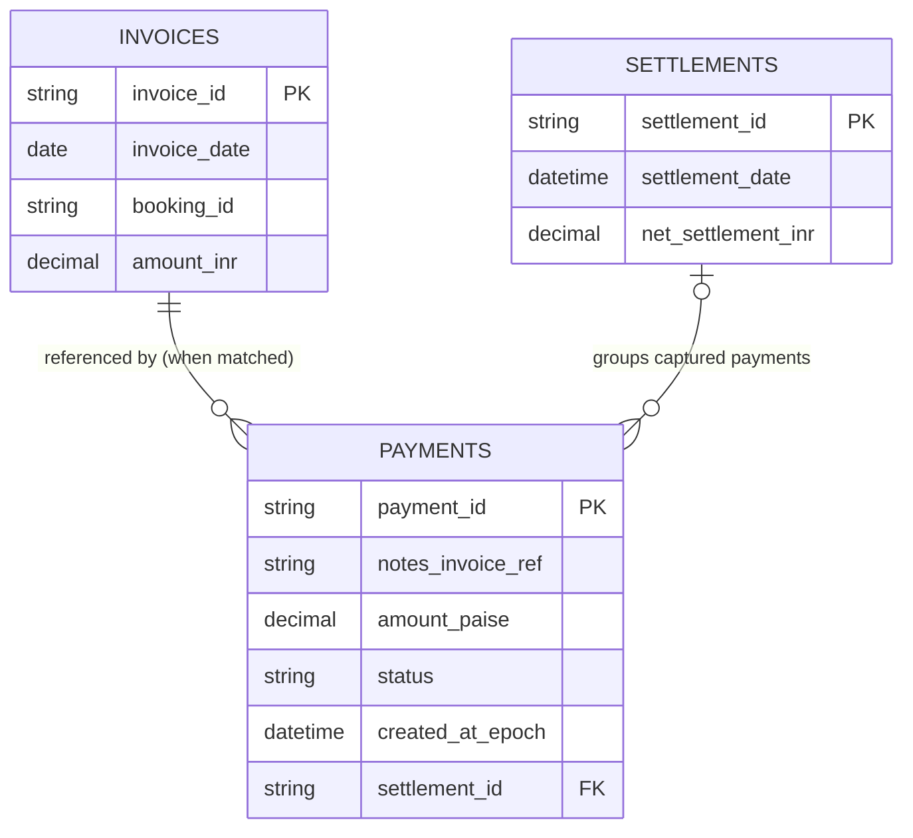
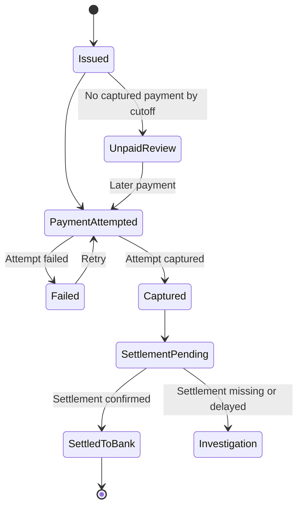
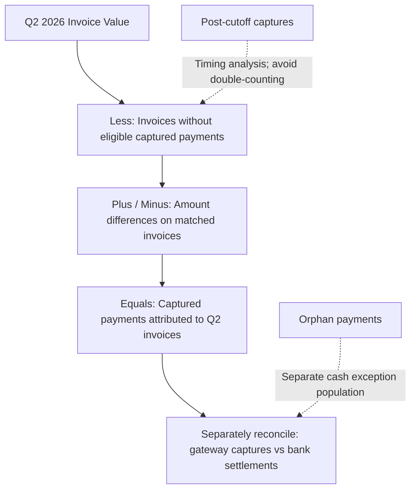
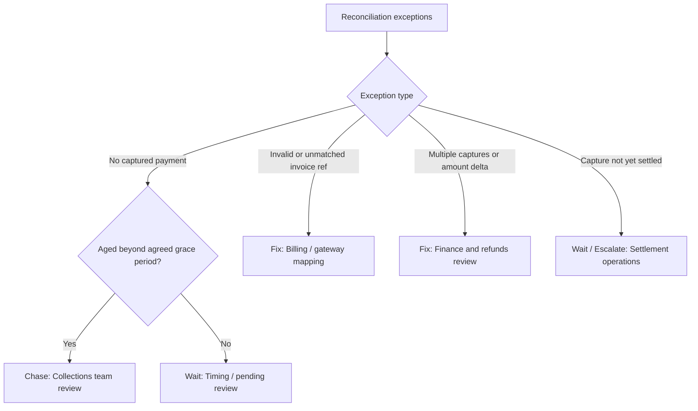

# Diagrams · Brief C · Group 4

Mermaid sources, rendered by GitHub when this file is opened in the repository, and exportable as PNG in `docs/diagrams/` for slides. Every diagram answers one question, named in its heading. These represent the analytical design for the billing-to-payment reconciliation; the cutoff, settlement handling and exception categories are validated against source data and finance policy (see the checklist at the end).

## · High-level design: the analysis as a pipeline

## · Entity model of the clean tables

**Cardinality caveat:** a payment may have no valid invoice match; a settlement ID may be absent or pending. The diagram models the *intended reference relationship*, not a guaranteed foreign key. Settlement fields are illustrative and are checked against the real settlement schema.

## · The life of an invoice, as a state machine

##  · The financial reconciliation bridge

**Bridge rule:** mutually exclusive categories, exact amounts. A post-cutoff capture cannot also count as a permanent unpaid loss. Orphan payments are not automatically attributable to Q2 invoices.

## · Exception triage and action ownership

**Policy caveat:** the seven-day timing rule is a working heuristic, not proof that every younger unpaid invoice is settlement float. Confirm against contractual payment terms and observed post-cutoff receipts.

